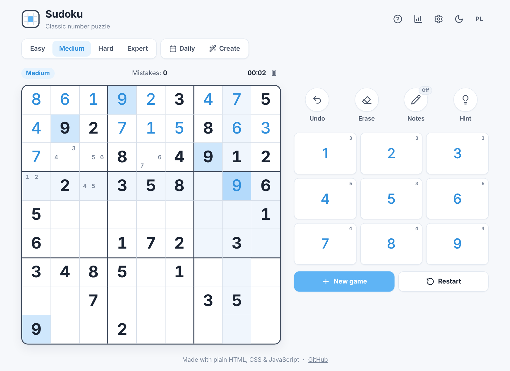
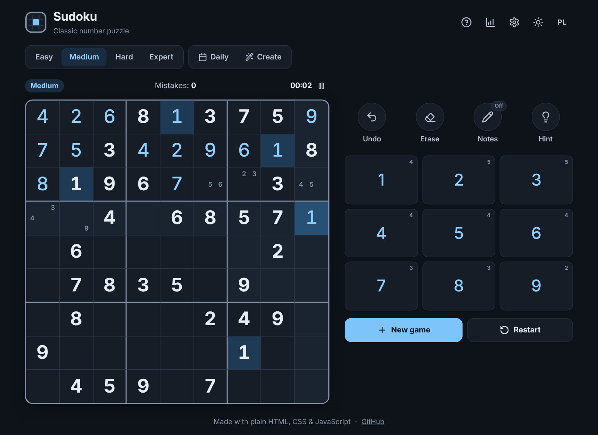
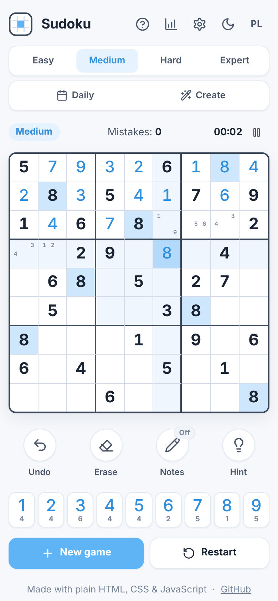

# Sudoku

A clean, fast Sudoku game that runs entirely in the browser — no frameworks, no build step, no dependencies.
It started as a small Python/tkinter backtracking solver and grew into a full game with a puzzle generator,
daily challenge, notes, hints, statistics, dark mode and offline support.

**▶ Play it:** `https://juliazubel.github.io/sudoku/` <!-- update after enabling GitHub Pages -->



<p align="center">
  
  &nbsp;
  
</p>

---

## Features

**Gameplay**
- **Four difficulty levels** — Easy, Medium, Hard and Expert. Every puzzle is generated on the fly and is guaranteed to have **exactly one solution**.
- **Daily challenge** — the same puzzle for everyone on a given day (seeded generator); difficulty changes with the day of the week.
- **Create mode / solver** — type in any puzzle (from a newspaper, a book, another app). The solver checks it live (*conflicts*, *no solution*, *multiple solutions*, *unique ✓*), can solve it instantly, or turn it into a playable game.
- **Notes (pencil marks)** with automatic clean-up when you place a digit.
- **Hints** — reveals the selected cell, or the most "logical" next cell (fewest candidates).
- **Undo / redo** for every move.
- **Mistake checking** with an optional *3 mistakes and you're out* mode.

**Comfort**
- Highlighting of the row, column, box and identical digits; flash animation when a row, column or box is completed.
- Number pad shows how many of each digit are left; finished digits fade out.
- Timer with pause (the board is hidden while paused) and **auto-pause** when you switch tabs.
- **Auto-save** — close the tab and continue later exactly where you left off.
- **Statistics** per difficulty: games played, won, best and average time, win rate and daily streak.
- **Light / dark theme** (follows the system by default) and **English / Polish** UI.
- Fully responsive — works great on phones, tablets and desktops.
- **Installable & offline** (PWA) — add it to your home screen and play without internet.

### Keyboard shortcuts

| Key | Action |
| --- | --- |
| `1`–`9` | Enter a digit |
| `Shift` + `1`–`9` | Toggle a note |
| `Backspace` / `Delete` / `0` | Erase |
| Arrow keys | Move the selection |
| `N` | Notes mode on / off |
| `Ctrl` + `Z` / `Ctrl` + `Y` | Undo / redo |
| `H` | Hint |
| `P` | Pause |
| `Esc` | Clear the selection |

---

## How it works

### Solver
The engine ([`js/sudoku.js`](js/sudoku.js)) stores the board as a flat array of 81 numbers and keeps the digits used in each
row, column and box as **9-bit masks**. The backtracking search always branches on the empty cell with the
**fewest candidates** (the *minimum remaining values* heuristic), which makes even the hardest puzzles solve in milliseconds.
The same search can count solutions (stopping at 2), which is how puzzles are checked for uniqueness.

### Generator
1. Fill an empty grid with the randomized solver → a random complete solution.
2. Remove clues in **symmetric pairs** (180° rotation, like classic printed puzzles), keeping a removal only if the puzzle
   still has exactly one solution.
3. Grade the difficulty with a small **human-style solver** that only knows *naked singles* and *hidden singles*:

| Level | Clues | Requirement |
| --- | --- | --- |
| Easy | ~40 | solvable with naked singles only |
| Medium | ~32 | solvable with naked + hidden singles |
| Hard | ~26–28 | fewest clues out of several attempts |
| Expert | ~22–25 | needs techniques beyond singles |

The daily challenge uses a seeded PRNG (*mulberry32*) with the date as the seed, so everyone gets the same puzzle.

---

## Project structure

```
.
├── index.html             # markup, dialogs and the SVG icon set
├── css/style.css          # all styles (light/dark themes via CSS variables)
├── js/
│   ├── sudoku.js          # engine: solver, generator, validation (no DOM — also runs in Node)
│   ├── i18n.js            # English / Polish translations
│   └── app.js             # game logic and UI: input, undo/redo, timer, stats, settings, storage
├── sw.js                  # service worker (offline cache)
├── manifest.webmanifest   # PWA manifest
├── assets/                # icons and social preview image
├── tests/sudoku.test.js   # unit tests for the engine (node:test)
├── python/sudoku_solver.py# the original desktop solver (tkinter), refreshed
└── docs/                  # screenshots for this README
```

---

## Running locally

Just open `index.html` in a browser — it works straight from the file system.

To test the offline mode (service workers need `http://`), start any static server:

```bash
python3 -m http.server 8000
# then open http://localhost:8000
```

### Tests

```bash
npm test        # or: node --test
```

The tests check parsing, solving, conflict detection, solution counting, uniqueness of generated puzzles for every
level, the difficulty ordering and reproducibility of the daily challenge. They also run automatically on GitHub
Actions (`.github/workflows/tests.yml`).

### Python version

```bash
python3 python/sudoku_solver.py
```

---

## Deploying to GitHub Pages

1. Create a new public repository (e.g. `sudoku`) and upload **all** files from this folder to its root
   (including the hidden `.nojekyll` and `.github/` folder).
2. Go to **Settings → Pages**, set **Source: Deploy from a branch**, branch **`main`**, folder **`/ (root)`**, and save.
3. After a minute the game is live at `https://<your-username>.github.io/<repository-name>/`.

> When you change files later, bump `CACHE` in `sw.js` (e.g. `sudoku-v2`) so returning players get the new version right away.

---

## Tech stack

HTML · CSS (custom properties, grid, container queries) · vanilla JavaScript · Service Worker / PWA · Node test runner · Python (tkinter)

## License

[MIT](LICENSE)
